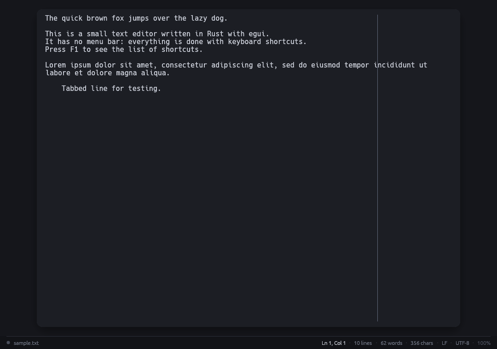

# mrs

A small, dark, menu-less plain-text editor written in Rust with
[egui](https://github.com/emilk/egui).



## Features

- Clean dark theme; the text area is a centered card with a subtle 80-column
  guide line.
- No menu bar. Everything is done with keyboard shortcuts (press **F1** for a
  cheat sheet).
- Built-in file browser for Open and Save As that matches the editor's theme:
  type a path or browse folders with the arrow keys and **Enter**.
- VS Code-style command palette (**Ctrl+Shift+P**) with fuzzy-free filtering and
  commands for new/open/save/save as, find and navigation, copy file path,
  delete line, zoom, toggles, keyboard shortcuts, clipboard viewer and quit.
- Status bar with file name, modified indicator, cursor position, selection
  size, line/word/character counts, line endings (LF/CRLF), encoding
  (UTF-8/UTF-8 BOM) and text zoom.
- Find bar with match highlighting, case-sensitivity toggle, and
  next/previous navigation (**Ctrl+F**, **F3**, **Shift+F3**).
- Go to line (**Ctrl+L**).
- Undo/redo, cut/copy/paste, selection, and tab indentation come from the
  underlying text widget.
- Delete the current line (or every line touched by the selection) with
  **Ctrl+Shift+K**.
- Opens files by path argument or drag & drop.
- Absolute path available on demand: hover the file name in the status bar to
  see it, click the name (or press **Ctrl+Shift+C**) to copy it.
- Preserves line endings and a UTF-8 BOM when saving.
- Detects files changed or deleted on disk before saving, with overwrite,
  reload and Save As choices.
- Adjustable text size (**Ctrl++**, **Ctrl+-**, **Ctrl+0**, also Ctrl+scroll).
- Asks before discarding unsaved changes.

## Build and run

```sh
cargo run --release
cargo run --release -- path/to/file.txt
```

Requires a Rust toolchain (edition 2024). File dialogs are drawn by the app
itself, so no desktop portal, GTK or `zenity` is needed.

## Install

The app and its binary are both called **mrs**, so they do not clash with an
existing `mousepad` installation. The recommended setup is user-local and
needs no `sudo`.

### Quick install (script)

The bundled script builds a release binary and installs it for the current
user, together with the desktop entry and icons:

```sh
./install.sh
```

Use `--system` for `/usr/local` (sudo as needed), `--prefix DIR` for a custom
location, `--no-build` to reuse an existing release binary, or `--uninstall`
to remove the installation. Run `./install.sh --help` for all options.

### User-local install (no sudo)

```sh
cargo build --release

install -Dm755 target/release/mrs ~/.local/bin/mrs
install -Dm644 assets/mrs.desktop \
    ~/.local/share/applications/mrs.desktop

for size in 16 24 32 48 128 256 512; do
    install -Dm644 assets/icons/mrs-${size}.png \
        ~/.local/share/icons/hicolor/${size}x${size}/apps/mrs.png
done

update-desktop-database ~/.local/share/applications
gtk-update-icon-cache -f -t ~/.local/share/icons/hicolor
```

`~/.local/bin` must be on your `PATH` (it usually is on desktop Linux).
Alternatively, Cargo can install just the binary:

```sh
cargo install --path . --root ~/.local --force
```

then install the launcher and icons as shown above.

### Launch

- From the application menu: **mrs** (under Utilities/Accessories).
- From a terminal:

  ```sh
  mrs
  mrs path/to/file.txt
  ```

### Installed files

| Item | Location |
| --- | --- |
| Binary | `~/.local/bin/mrs` |
| Desktop launcher | `~/.local/share/applications/mrs.desktop` |
| Icons | `~/.local/share/icons/hicolor/<size>/apps/mrs.png` |

### Reinstall after changing the code

```sh
./install.sh
```

or, to skip the rebuild and only copy the existing release binary:

```sh
./install.sh --no-build
```

### System-wide install (needs sudo)

```sh
cargo build --release

sudo install -Dm755 target/release/mrs /usr/local/bin/mrs
sudo install -Dm644 assets/mrs.desktop /usr/share/applications/

for size in 16 24 32 48 128 256 512; do
    sudo install -Dm644 assets/icons/mrs-${size}.png \
        /usr/share/icons/hicolor/${size}x${size}/apps/mrs.png
done

sudo update-desktop-database /usr/share/applications
sudo gtk-update-icon-cache -f -t /usr/share/icons/hicolor
```

### Uninstall

```sh
rm -f ~/.local/bin/mrs
rm -f ~/.local/share/applications/mrs.desktop
rm -f ~/.local/share/icons/hicolor/*/apps/mrs.png
update-desktop-database ~/.local/share/applications
gtk-update-icon-cache -f -t ~/.local/share/icons/hicolor
```

## Keyboard shortcuts

| Shortcut | Action |
| --- | --- |
| Ctrl+N | New document |
| Ctrl+O | Open file |
| Ctrl+S | Save |
| Ctrl+Shift+S | Save as |
| Ctrl+Shift+C | Copy the absolute file path |
| Ctrl+Q | Quit |
| Ctrl+Shift+P | Command palette |
| Ctrl+F | Find (pre-fills a selected word) |
| F3 / Shift+F3 | Find next / previous |
| Ctrl+L | Go to line |
| Ctrl+Z | Undo |
| Ctrl+Y or Ctrl+Shift+Z | Redo |
| Ctrl+X / C / V / A | Cut / copy / paste / select all |
| Ctrl+Shift+K | Delete the current line |
| Ctrl++ / Ctrl+- / Ctrl+0 | Larger / smaller / reset text size |
| F1 | Shortcut help |
| F2 | Clipboard contents |
| Esc | Close find/goto bar or a dialog |

## Layout

- `src/main.rs` – window setup and entry point
- `src/app.rs` – editor state, UI, shortcuts and file handling
- `src/save.rs` – atomic file replacement
- `src/text.rs` – encodings, line endings, statistics and search (unit-tested)
- `src/theme.rs` – the dark color palette and egui styling
- `install.sh` – build and install script (user-local, system-wide or custom prefix)
- `assets/` – application icon (SVG + PNG sizes) and desktop entry
